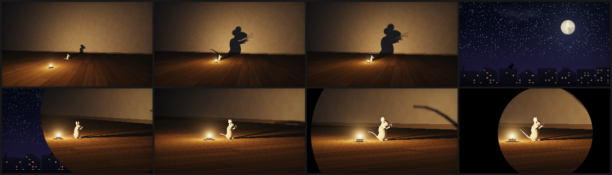

# shotglass

Compose short films and cartoons from GLSL shaders. Shots, transitions and
GPU-synthesised sound sit on one scrubbable timeline, with live reload and
headless stills. Rust + OpenGL, no browser.



- **Shots are Shadertoy-style `.glsl` files.** Write `mainImage`, use `iTime` and
  `iResolution`, and declare nothing else. Most Shadertoy code pastes straight in.
- **Transitions combine two shots.** There are built-in fades, irises, dissolves and wipes,
  or you can write your own using the [gl-transitions](https://gl-transitions.com)
  `getFromColor` / `getToColor` / `progress` convention.
- **The sound is GLSL too.** Music runs across the cuts, each shot can have its own
  sound that fades with the transitions, and an optional mix pass adds echo, reverb
  or ducking. All of it is synthesised on the GPU.
- **The sound card is the clock.** A slow frame is skipped instead of drifting out
  of sync, and adaptive resolution keeps frames on time.
- **Live reload.** Save a shader or `movie.toml` and the player reloads in place
  at the same moment. A broken shader shows its errors (with correct file:line)
  while the last working version keeps playing.

## Quick start

You need [Rust](https://rustup.rs) and a GPU with OpenGL 3.3 or newer.

```sh
git clone https://github.com/antonmarsden/shotglass
cd shotglass
cargo run --release -- play movies/big-shadow
```

To start your own film:

```sh
cargo run --release -- new movies/my-film
cargo run --release -- play movies/my-film
```

Or install it with `cargo install --path .`, then run `shotglass play movies/my-film`.

## A movie

A movie is a folder:

```
movies/big-shadow/
├── movie.toml          the edit: shots, timings, uniforms, transitions
├── common.glsl         shared helpers (#include "../common.glsl")
├── scenes/
│   ├── shadow.glsl
│   ├── moon.glsl
│   └── black.glsl
├── music.glsl          vec2 mainSound(int samp, float time), movie time
├── sfx/                one sound per shot, shot time
│   ├── candle.glsl
│   ├── plucks.glsl
│   └── thump.glsl
└── mix.glsl            vec2 mainMix(int samp, float time)
```

`movie.toml`:

```toml
title = "Big Shadow"
aspect = [16, 9]
fps = 30                      # for frame stepping and iFrame; playback follows the display

[sound]
music = "music.glsl"          # optional
mix = "mix.glsl"              # optional; without it, music and shot sounds are summed
volume = 0.9

[[shot]]
id = "wall"
scene = "scenes/shadow.glsl"
duration = 9.0
uniforms.uRadius = 0.003                                       # float
uniforms.uOrbit  = [0.0, 0.0]                                  # vec2 (up to vec4)
uniforms.uDist   = { keys = [[0, 0.95], [6, 0.22]], ease = "smoother" }
uniforms.uLight  = { keys = [[0, 1], [6.4, 1], [8.2, 0, "in"]] }   # per-key ease
sound = "sfx/candle.glsl"     # this shot's sound

[[shot]]
id = "moon"
scene = "scenes/moon.glsl"
duration = 8.0
# The transition *into* this shot. No transition = a hard cut.
transition = { type = "fade", duration = 1.4, params = { hold = 0.25 } }

[[shot]]
id = "closeup"
scene = "scenes/shadow.glsl"     # shots can reuse a scene with different uniforms
duration = 8.0
time_offset = 20.0               # iTime starts here (default 0); time_scale also available
transition = { type = "iris", duration = 1.5, freeze = true, ease = "inout", params = { center = [0.72, 0.70] } }
sound = "sfx/plucks.glsl"
sound_lead = 0.6                 # start the sound before the picture (J-cut); sound_tail lets it ring on

[[marker]]
t = 6.4
label = "flame gutters"
```

Shots overlap by the length of the transition between them, so a 9 s shot
followed by a 1.4 s transition hands over at 7.6 s. `shotglass check` reports
any transition that is longer than its shots allow.

Keyframe times are in shot-local seconds. The eases are `linear`, `smooth`
(default), `smoother`, `in`, `out`, `inout` and `step`.

### Scene shaders

Scene shaders are written like Shadertoy shaders:

```glsl
void mainImage(out vec4 fragColor, in vec2 fragCoord) {
    vec2 uv = fragCoord / iResolution.xy;
    fragColor = vec4(uv, 0.5 + 0.5 * sin(iTime), 1.0);
}
```

These uniforms are available:

| uniform | meaning |
|---|---|
| `iResolution`, `iTime`, `iTimeDelta`, `iFrame`, `iFrameRate`, `iDate`, `iMouse` | as on Shadertoy. `iTime` is the shot's own clock (plus `time_offset`) |
| `iShotTime`, `iShotDuration`, `iShotProgress` | shot-local seconds, the shot's length, and 0→1 over the shot |
| `iMovieTime` | seconds since the start of the movie |
| `iChannel0..3` | declared so pasted code compiles; they are bound to black for now |
| your `uniforms.*` | declared automatically from `movie.toml` |
| `CUE_<ID>_START`, `CUE_<ID>_SETTLED`, `CUE_<ID>_END`, `MOVIE_DURATION` | `#define`s from the edit (`SETTLED` = the incoming transition has finished) |

`#include "file.glsl"` works relative to the including file, then relative to the movie folder.

### Transitions

| type | params (defaults) |
|---|---|
| `crossfade` | – |
| `fade` | `color = [0,0,0]`, `hold = 0` (fraction of the transition spent fully on the colour) |
| `iris` | `center = [0.5,0.5]`, `softness = 0.004`, `closing = 0` (1 = shrink onto the old shot) |
| `dissolve` | `scale = 9`, `softness = 0.08` |
| `wipe` | `direction = [1,0]`, `softness = 0.01` |

A custom transition is a `.glsl` file referenced by path, e.g. `type = "transitions/heart.glsl"`:

```glsl
#ifndef softness
#define softness 0.02          // each param arrives as a #define
#endif
vec4 transition(vec2 uv) {     // uv is 0..1; ratio = width / height
    vec2 p = (uv - 0.5) * vec2(ratio, 1.0);
    p.y -= 0.25 * abs(p.x);                                          // a rough heart
    float r = progress * 1.4;
    float inside = smoothstep(r + softness, r - softness, length(p * vec2(1.0, 1.4)));
    return mix(getFromColor(uv), getToColor(uv), inside);
}
```

To port a shader from gl-transitions, turn its `uniform float x; // = 0.3` lines
into the `#ifndef` / `#define` form shown above.

`freeze = true` renders the outgoing shot once, at the frame where the
transition starts, and holds it. Only the incoming shot renders live, so the
transition costs about the same as a normal frame. This works well for wipes and
irises. Leave it off for slow dissolves, where a still frame looks dead.

### Sound

All sound is GLSL, synthesised on the GPU when the movie loads. It comes in three layers:

```
music.glsl   movie time, runs across cuts ───────────────► music() ─┐
shot sounds  shot time + shot uniforms, faded per transition ► sfx() ─┼─► mix.glsl ─► speakers
                                                                     (or music + sfx)
```

**Music** (`[sound] music`) is `vec2 mainSound(int samp, float time)` with `time` in
movie seconds. Use the cue `#define`s to place it against the edit:

```glsl
vec2 mainSound(int samp, float time) {
    float k = smoothstep(CUE_MOON_START, CUE_MOON_SETTLED, time);   // follow the fade
    float s = 0.2 * sin(6.2831 * mix(110.0, 146.8, k) * time);
    return vec2(s);
}
```

**Shot sounds** (`sound = "sfx/candle.glsl"` on a shot) use the same signature, but
`time` is shot-local (like `iTime`) and the shot's uniforms are available, evaluated
at that time. The candle in the demo multiplies by `uLight`, so its crackle dies
exactly when the flame does. Shot sounds move with their shot when you retime the
edit. During a transition the outgoing and incoming sounds crossfade, using the
transition's ease and equal-power gains. `sound_lead` starts a sound before its
shot (a J-cut; `time` is negative during the lead), and `sound_tail` lets it ring
on after the shot. In both cases the sound skips the fade on that side.
`sound_gain` scales it.

**The mix** (`[sound] mix`) is optional: `vec2 mainMix(int samp, float time)` runs
after everything else and can read any sample of the two buses. That makes
delays, echoes and multi-tap reverbs cheap lookups, which a single `mainSound`
can't do:

```glsl
vec2 mainMix(int samp, float time) {
    int ms = int(iSampleRate * 0.001);
    vec2 echo = music(samp - 310 * ms) * 0.35;                       // 310 ms echo
    float duck = 1.0 - 0.7 * smoothstep(0.12, 0.35, sfxLevel(samp)); // music dips under loud effects
    return (music(samp) + echo) * duck + sfx(samp);
}
```

Each track is cached by its source and timing. Editing one shot's sound
re-synthesises only that shot (and the mix), and picture-only edits don't touch
the sound. Recursive filters (resonant sweeps, feedback reverb) are the main
thing GLSL sound can't do cheaply. Multi-tap delays in the mix get you most of
the way.

## The player

`shotglass play <movie> [--at 12.5 | --at moon | --at moon+2]`

| key | action |
|---|---|
| Space | play / pause |
| ← → | step one frame |
| Shift + ← → | ±1 second |
| `[` `]` | previous / next shot |
| `,` `.` | jump to just before the previous / next transition |
| L | loop the shot or transition under the playhead (or double-click the timeline) |
| 1 2 3 | speed ¼×, ½×, 1× |
| Q | cycle render scale: auto, 100%, 50% |
| M | mute |
| R | reload now |
| H / Tab | hide the side panel |

To scrub, click or drag on the timeline. Hatched blocks are transitions;
"(frozen)" marks transitions that use `freeze`.

### Avoiding frame drops

- **Audio is the master clock.** The picture always shows the frame for the
  sample being heard, so a late frame never causes drift.
- **Adaptive resolution.** Auto mode times each frame on the GPU (`GL_TIME_ELAPSED`)
  and lowers the shot render scale before frames start missing the display
  refresh, then raises it again when there's headroom. When you pause, it renders
  at full quality.
- **Shaders compile and warm up at load**, with one tiny draw each, so a shot's
  first frame doesn't stall the playback.
- **Frozen transitions** render only one scene.
- `shotglass check` times every shot and transition, so you can see which ones
  are over budget.

## Command line

```sh
shotglass play   <movie> [--at T]
shotglass still  <movie> --at 3.5,moon,closeup+2 [--size 1280x720] [--out stills/]
shotglass strip  <movie> [--count 12 | --at ...] [--size 384x216] [--cols 4] [--out strip.png]
shotglass check  <movie> [--size 1280x720] [--frames 8]   # validate, compile, synth, time
shotglass wav    <movie> [--out sound.wav] [--rate 48000]
shotglass new    <dir>
```

`still`, `strip`, `check` and `wav` render off-screen. On a Linux machine with
no display, run them under `xvfb-run`; Mesa's software OpenGL works.

## Licence

Licensed under either of [Apache License 2.0](LICENSE-APACHE) or
[MIT](LICENSE-MIT), at your option.

Shaders copied from shadertoy.com are usually licensed CC BY-NC-SA 3.0 by their
authors. If you include them in a movie, keep their licence notes with them.
